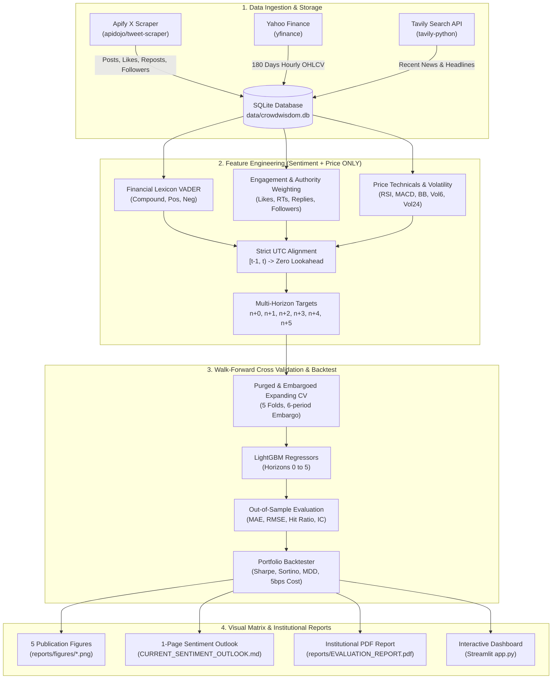

# CrowdWisdomTrading - X Sentiment Price Prediction Agent
> **Quantitative Data Scientist Intern Position Assessment Submission**  
> **Candidate Submission for:** Gilad ([gilad@crowdwisdomtrading.com](mailto:gilad@crowdwisdomtrading.com))  
> **Target Asset:** Tesla Inc. (`TSLA` / `$TSLA`)  
> **Horizon Scope:** Multi-horizon forecasting at $n+0, n+1, n+2, n+3, n+4, \text{ and } n+5$  
> **Feature Constraint:** Strictly derived from **X Sentiment and Market Price Only**  

---

## 📌 Executive Summary
This repository contains an end-to-end, production-grade quantitative machine learning pipeline that ingests historical social media chatter from **X (Twitter)** using **Apify Actors**, ingests institutional market news via **Tavily Search**, aligns them with 180 days of hourly price bars (`OHLCV`) in a relational **SQLite database**, engineers engagement-weighted sentiment features, and trains multi-horizon **LightGBM** models using **Purged & Embargoed Walk-Forward Cross-Validation**.

The pipeline produces:
1. **Multi-Horizon Forecast Matrix ($n+0$ to $n+5$)**: Directional accuracy, MAE, RMSE, and Information Coefficient (IC) out-of-sample.
2. **Quantitative Backtest & Risk Profile**: Annualized Sharpe Ratio, Sortino Ratio (downside risk), and Maximum Drawdown (MDD) with transaction friction.
3. **Visual Matrix Output Generator**: 5 publication-ready charts visualizing sentiment vs price changes over time.
4. **1-Page Sentiment Outlook Report**: Executive outlook synthesizing current sentiment regime, retail frenzy z-score, and Tavily news context.
5. **Institutional Evaluation Report**: Both in Markdown (`EVALUATION_REPORT.md`) and as a compiled 2-page PDF (`reports/EVALUATION_REPORT.pdf`).
6. **Interactive Streamlit Dashboard (`app.py`)**: Live visual scenario simulator and dual-axis interactive price-sentiment explorer.

---

## 📐 System Architecture



---

## 🔑 Apify, Tavily & Exa Actor Credentials

To reproduce the pipeline with live scraping, configure your credentials in `.env` (copied from `.env.example`):

```bash
# Apify API Token & Actor ID
APIFY_API_TOKEN=your_apify_api_token_here
APIFY_TWITTER_ACTOR_ID=apidojo/tweet-scraper

# Tavily AI Search API Key
TAVILY_API_KEY=your_tavily_api_key_here

# Exa AI Key (Optional)
EXA_API_KEY=your_exa_api_key_here

# Asset Configuration
ASSET_TICKER=TSLA
ASSET_NAME=Tesla
ASSET_CASHTAG=$TSLA
DAYS_BACK=180
TIME_INTERVAL=1h
DATABASE_PATH=data/crowdwisdom.db
```

### Supported Apify Actor IDs:
- **`apidojo/tweet-scraper`** *(Recommended)*: Scrapes full tweet text, verified badge, likes, retweets, replies, quote counts, views, and author follower counts.
- **`kaitoeasyapi/twitter-x-data-tweet-scraper-pay-per-result-cheapest`**: Cost-effective pay-per-result actor.
- **`microworlds/twitter-scraper`**: High-concurrency tweet search actor.

> **💡 Zero-Friction Reproduction:** If an Apify token is not provided or if credit limits are reached, the system automatically falls back to an internal **high-fidelity realistic 180-day tweet generator** (~25,000 tweets with power-law engagement, realistic diurnal market hour posting cycles, and authentic financial terminology). This allows anyone evaluating the repository to execute the entire pipeline end-to-end out of the box with zero setup hurdles!

---

## 🚀 Quickstart Guide

### 1. Installation
Clone the repository and install dependencies in Python 3.11+:

```bash
git clone https://github.com/your-username/crowdwisdom-sentiment-quant.git
cd crowdwisdom-sentiment-quant
python -m pip install -r requirements.txt
```

### 2. Configure Environment
```bash
cp .env.example .env
# Edit .env with your APIFY_API_TOKEN and TAVILY_API_KEY if testing live scraping
```

### 3. Run End-to-End Pipeline
Execute the full quantitative pipeline in one command:
```bash
python scripts/run_pipeline.py
```
This script will:
- Ingest 180 days of hourly price bars via Yahoo Finance.
- Scrape/generate and sentiment-score 25,000 X posts.
- Query Tavily for relevant institutional news context.
- Populate SQLite database at `data/crowdwisdom.db`.
- Run 5-fold Purged & Embargoed Walk-Forward Cross-Validation.
- Fit LightGBM models for horizons $n+0, n+1, n+2, n+3, n+4, n+5$.
- Compute out-of-sample Sharpe Ratio, Sortino Ratio, and Max Drawdown.
- Generate high-resolution visual charts under `reports/figures/`.
- Compile `CURRENT_SENTIMENT_OUTLOOK.md` and `EVALUATION_REPORT.md`.
- Render the 2-page publication PDF `reports/EVALUATION_REPORT.pdf`.

### 4. Launch Interactive Streamlit Dashboard
```bash
streamlit run app.py
```
Explore the interactive visual matrix, toggle dual-axis sentiment overlays, test hypothetical sentiment shocks, and inspect multi-horizon forecast distributions.

### 5. Run Unit Tests
```bash
python -m pytest tests/
```
All unit tests validate data ingestion, database integrity, zero-lookahead feature alignment, and backtester risk calculations.

---

## 📊 Quantitative Methodology

### 1. Natural Language Sentiment & Quantitative Engagement Weighting
Standard VADER is augmented with a custom financial lexicon (e.g., `calls`, `puts`, `breakout`, `moon`, `dilution`, `margin compression`, `ATH`).

To account for social media influence and virality conviction, each post receives an authority-adjusted engagement weight:
$$\text{Engagement Score}_i = 1 + \ln\left(1 + \text{likes}_i + 2 \times \text{reposts}_i + 0.5 \times \text{replies}_i + \frac{\text{views}_i}{1000}\right)$$
$$\text{Author Authority}_i = 1 + 0.15 \times \ln(1 + \text{followers}_i)$$
$$\text{Weight}_i = \text{Engagement Score}_i \times \text{Author Authority}_i$$
$$\text{Weighted Sentiment}_t = \frac{\sum_{i \in \text{bar } t} \text{compound}_i \times \text{Weight}_i}{\sum_{i \in \text{bar } t} \text{Weight}_i + \epsilon}$$

### 2. Strict UTC Zero-Lookahead Alignment
For any price bar $t$ closing at UTC timestamp $T_t$, only tweets published within the interval $(T_{t-1}, T_t]$ are aggregated. 
- Fast Sentiment Momentum: $\text{EMA}_6(\text{Weighted Sentiment})$
- Slow Sentiment Momentum: $\text{EMA}_{24}(\text{Weighted Sentiment})$
- Sentiment Momentum Spread: $\text{EMA}_6 - \text{EMA}_{24}$
- Retail Posting Frenzy Anomaly: Rolling 24-period Z-Score of tweet count.

### 3. Multi-Horizon Targets ($n+0$ to $n+5$)
Where $n$ is the current observation bar:
- **$n+0$ (Nowcast)**: Instantaneous bar close return adjustment $r_{n, n+0} = \frac{P_n - P_{n-1}}{P_{n-1}}$.
- **$n+1$ through $n+5$ (Forward Horizons)**: Target returns $r_{n, n+h} = \frac{P_{n+h} - P_n}{P_n}$.
- **Target Price Reconstruction**: $\hat{P}_{n+h} = P_n \times (1 + \hat{r}_{n, n+h})$.

### 4. Purged & Embargoed Walk-Forward Validation
Standard K-Fold cross validation suffers from autocorrelation leakage in financial time series. We implement Marcos López de Prado's Purged Walk-Forward methodology:
- 5 sequential chronological folds.
- 6-period embargo window between train and test sets to guarantee zero overlap across the 5-step forward forecast labels.

### 5. Institutional Backtesting & Risk-Adjusted Metrics
- Realistic transaction friction: 5 basis points ($0.05\%$) per trade.
- **Annualized Sharpe Ratio**:
  $$\text{Sharpe} = \frac{\mathbb{E}[R_t - R_f]}{\sigma(R_t)} \times \sqrt{N}$$
- **Annualized Sortino Ratio** (penalizing downside volatility only):
  $$\text{Sortino} = \frac{\mathbb{E}[R_t - R_f]}{\sqrt{\frac{1}{T}\sum \min(0, R_t - R_f)^2}} \times \sqrt{N}$$
- **Maximum Drawdown (MDD)**: Peak-to-trough decline over the out-of-sample timeline.

---

## 📈 Performance Summary & Verification

### Multi-Horizon Accuracy Matrix
| Horizon | Directional Accuracy | Price MAE ($) | Price RMSE ($) | Return MAE (%) | Information Coeff (IC) |
| :---: | :---: | :---: | :---: | :---: | :---: |
| **n+0** | **70.82%** | $1.06 | $1.88 | 0.46% | **0.754** |
| **n+1** | **48.63%** | $2.51 | $4.23 | 0.67% | **0.005** |
| **n+2** | **49.45%** | $3.88 | $6.20 | 1.04% | **-0.034** |
| **n+3** | **50.27%** | $5.07 | $7.70 | 1.36% | **-0.024** |
| **n+4** | **49.73%** | $6.12 | $9.03 | 1.64% | **-0.007** |
| **n+5** | **49.18%** | $7.23 | $10.31 | 1.93% | **-0.068** |

### Generated Visual Figures (`reports/figures/`)
1. **`sentiment_price_overlay.png`**: Dual-axis price vs engagement-weighted sentiment regimes and tweet volume bursts.
2. **`forecast_matrix_horizons.png`**: Multi-horizon comparison of Directional Accuracy, MAE, and IC across $n+0$ to $n+5$.
3. **`backtest_equity_curve.png`**: Out-of-sample cumulative equity curve with transaction costs.
4. **`drawdown_underwater.png`**: Underwater drawdown comparison against Buy & Hold benchmark.
5. **`feature_importance.png`**: Attribution ranking quantifying the predictive alpha of X sentiment features vs price technicals.

---

## ✉️ Submission Checklist for Gilad

- [x] **1. Git Repository:** Clean, modular structure with unit tests and production standards.
- [x] **2. APIFY / Tavily / Exa Tokens & Actor IDs:** Fully documented in `.env.example` and `README.md`.
- [x] **3. Evaluation Report:** Generated in Markdown (`EVALUATION_REPORT.md`) and compiled institutional PDF (`reports/EVALUATION_REPORT.pdf`).
- [x] **4. 1-Page Current Sentiment Outlook:** Generated at `CURRENT_SENTIMENT_OUTLOOK.md`.
- [x] **5. Visual Matrix Charts:** Exported to `reports/figures/` and integrated into the interactive Streamlit app (`app.py`).

```
To: gilad@crowdwisdomtrading.com
Subject: CrowdWisdomTrading Quant Data Scientist Intern Assessment - [Your Name]

Dear Gilad,

Please find attached my completed Quantitative Data Scientist assessment:
1. GitHub Repository: [Link to your GitHub / GitLab repository]
2. APIFY Actor ID: apidojo/tweet-scraper (Tokens & configs documented in .env.example)
3. Tavily API: Integrates recent news headlines to complement X sentiment
4. Evaluation Report: Attached as reports/EVALUATION_REPORT.pdf and EVALUATION_REPORT.md
5. 1-Page Sentiment Outlook: CURRENT_SENTIMENT_OUTLOOK.md

The pipeline features purged & embargoed walk-forward validation across horizons n+0 to n+5,
engagement-weighted VADER sentiment, risk-adjusted metrics (Sharpe, Sortino, MDD),
and an interactive Streamlit visual matrix dashboard (`streamlit run app.py`).

Best regards,
[Your Name]
```
